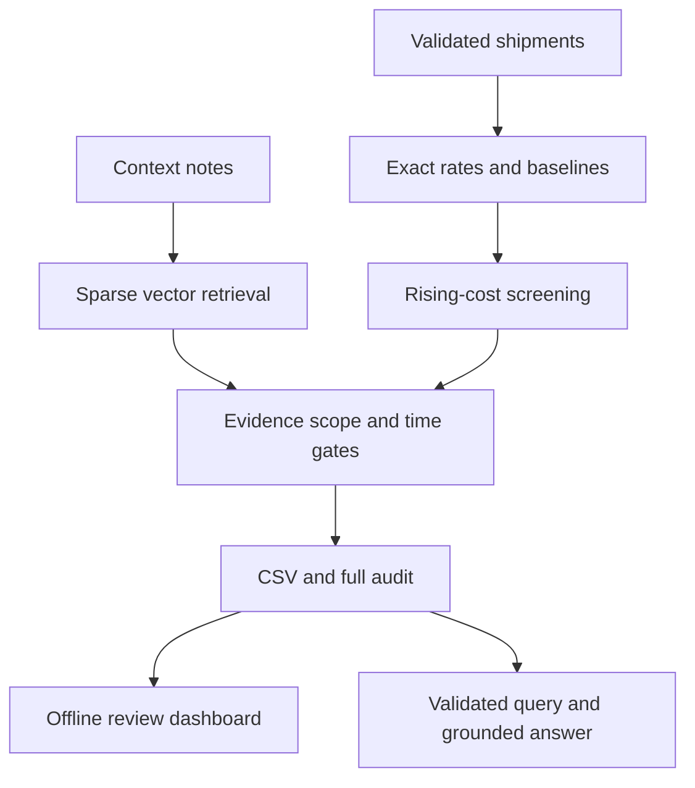

# Design and trade-offs

Calculation and evidence decisions never depend on language-model output. Core code uses Python's standard library. The dashboard embeds its data and JavaScript with no network dependencies.

| Choice | Benefit | Cost / limitation |
|---|---|---|
| Ratio of freight sum to tonne-km sum | Actual cost per transport work | Within-week mix can still confound |
| Arithmetic mean of weekly historical rates | Exact specified comparison | Persistent inflation enters the baseline |
| Equal-weight route peer mean | Exact same-type comparison | Only 1–2 peers per group here |
| Prior 56-day window | No stale observations substituted for missing weeks | Sparse weeks mean fewer samples |
| Explicit rise and anomaly thresholds | Transparent and tunable | Not statistically calibrated |
| TF-IDF sparse vectors | Local, deterministic, inspectable | Limited paraphrase understanding |
| Retrieve all ten notes then gate | No arbitrary top-k miss | Audit size grows with corpus |
| Scope/date/effect/magnitude rules | Relevant-sounding notes cannot invent applicability | Unfamiliar language can be rejected |
| Onset-only unknown-duration attribution | No unlimited cost excuse | Conservative false positives possible |
| Template explanations | Exact source and stable facts | Less conversational |
| Optional model only for query planning | Natural language without model-authored facts | Restricted query schema |

## Retrieval

Lowercase alphanumeric tokens, a small stop-word list, and route scope plus note text form each document. Weight is `(1 + log(tf)) * (log((N + 1)/(df + 1)) + 1)`, followed by L2 normalization. Dot product gives cosine similarity. Unseen query terms contribute zero. Ties use note IDs. Indexing happens once per run; no random state or vector-database service is needed.

Retrieval score is lexical relevance, not confidence. Eligibility is a separate gate. Audits keep every score and rejection so retrieval and reasoning failures can be distinguished.

## Time

Input dates have no timezone component. Weeks are Monday–Sunday. History strictly precedes the current week; peers are contemporaneous. Notes must have publication dates at or before Sunday: this is end-of-week retrospective analysis, not live event-time simulation. Explicit windows have inclusive endpoints and require an overlapping shipment date. Supported temporal grammar is narrow; it is not a general natural-language date parser.

## Contract

| Field | Format |
|---|---|
| route | origin-destination, directional |
| week_of | ISO Monday date |
| cost_per_tonne_km | Two-decimal numeric string |
| vs_own_history | Signed one-decimal percentage with sample suffix, or N/A |
| vs_similar_routes | Signed one-decimal percentage with sample suffix, or N/A |
| flagged | Yes / No (justified) / No |
| matched_note_id | Exact eligible ID for justified candidates; blank otherwise |
| reason | Grounded verdict and exact source text when justified |

All observed route-weeks are exported. Extra fields belong in the audit JSON, not extra CSV columns. Inputs and outputs are hashed. Default files have stable ordering, UTF-8 encoding, and no run timestamps. Three-run proof is a separate artifact.

## Evaluation boundaries

The independent numerical reference uses high-precision Decimal values read directly from CSV strings. Regression labels are a small development set, not a production benchmark. Metamorphic tests establish shuffle and no-look-ahead invariants. Model mocks test adapter logic, not inference quality. UI validation status is reported separately.

## Scaling

The current implementation scans a route's weekly history and its same-week peer group; it scans ten notes per route-week. This is sufficient for the supplied 2,940 shipments. At larger scale, use incremental aggregates, rolling deques, indexed route/time metadata, versioned events, and a persistent evidence store. Add a vector database when persistence, corpus size, or multi-user ingestion requires it.

Production needs reviewed labels, temporal holdouts, composition diagnostics, calibrated alert capacity, review workflows, data drift checks, access controls, and retention policies. Preserve the mandated simple baselines for comparability if a richer residual model is added.
